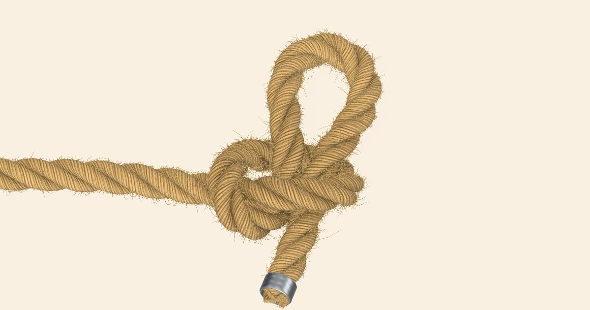
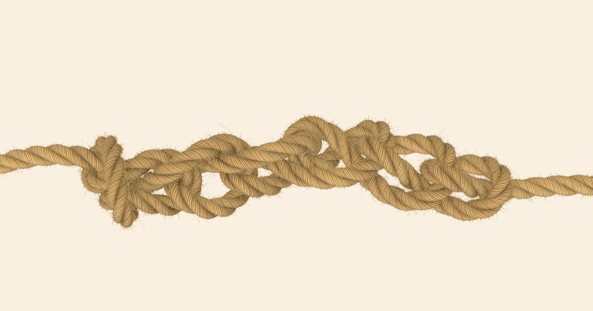

# Knots Made Easy

See how knots are tied, step by step, with a physically simulated rope.

**[knots-made-easy.pages.dev](https://knots-made-easy.pages.dev)**

## Knots

<table>
  <tr>
    <td align="center"><a href="https://knots-made-easy.pages.dev/knots/overhand/"><br>Overhand knot</a></td>
    <td align="center"><a href="https://knots-made-easy.pages.dev/knots/slip-knot/"><br>Slip knot</a></td>
    <td align="center"><a href="https://knots-made-easy.pages.dev/knots/figure-eight/"><br>Figure-eight knot</a></td>
  </tr>
  <tr>
    <td align="center"><a href="https://knots-made-easy.pages.dev/knots/bowline/"><br>Bowline</a></td>
    <td align="center"><a href="https://knots-made-easy.pages.dev/knots/clove-hitch/"><br>Clove hitch</a></td>
    <td align="center"><a href="https://knots-made-easy.pages.dev/knots/zeppelin/"><br>Zeppelin bend</a></td>
  </tr>
  <tr>
    <td align="center"><a href="https://knots-made-easy.pages.dev/knots/square-knot/"><br>Square knot</a></td>
    <td align="center"><a href="https://knots-made-easy.pages.dev/knots/poachers-knot/"><br>Poacher's knot</a></td>
    <td align="center"><a href="https://knots-made-easy.pages.dev/knots/daisy-chain/"><br>Daisy chain</a></td>
  </tr>
  <tr>
    <td align="center">🪢<br><b>More knots are being tied</b><br>Star the repo to see them first</td>
  </tr>
</table>

## The stargazer rope

Every GitHub star ties a knot. Star the repo and your face joins the rope.

[](https://knots-made-easy.pages.dev/stargazers/)

## Run it

Needs Node 22.22+ and pnpm.

```bash
pnpm install
pnpm dev
```

React, React Router and three.js, no physics library. [AGENTS.md](AGENTS.md) explains how it fits
together and how to add a knot.
