<div align="center">
  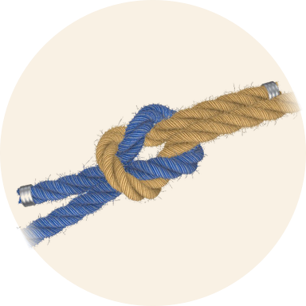
  <h1>Knots Made Easy</h1>
  <p>See how knots are tied, step by step, with a physically simulated 3D rope.</p>

<a href="https://github.com/behnamazimi/knots/stargazers"></a>
<a href="https://github.com/behnamazimi/knots/releases"></a>
<a href="https://github.com/behnamazimi/knots/releases"></a>
<a href="https://github.com/behnamazimi/knots/actions/workflows/ci.yml"></a>
<a href="LICENSE"></a>

  <p>
    <a href="https://knots-made-easy.pages.dev"><strong>Web App</strong></a> ·
    <a href="https://github.com/behnamazimi/knots/releases/latest"><strong>Android APK</strong></a> ·
    <a href="https://apps.obtainium.imranr.dev/redirect?r=obtainium://add/https://github.com/behnamazimi/knots"><strong>Get it on Obtainium</strong></a>
  </p>
</div>

## Features

- **Real-time 3D Rope Physics**: Cosserat rod XPBD simulation rendered in WebGL2 with Three.js — no canned animations or pre-baked keyframes.
- **Interactive Step-by-Step Playback**: Scrub, pause, loop, orbit, and pinch-to-zoom around every step of tying a knot.
- **Offline Android App**: Bundled web assets inside a native Android shell so all 9 knots work without an internet connection.
- **Favorites & QR Sharing**: Save your go-to knots and share or import favorites via QR code.
- **Appearance & Performance**: Light, dark, and system themes, plus High Fidelity (24 XPBD substeps) and Battery Saver (low-density rope mesh, no shadows, 1× pixel ratio) modes.
- **In-App Update Checker**: Checks GitHub Releases for newer versions and opens the release APK in your browser (or manage updates automatically via [Obtainium](https://obtainium.imranr.dev/)).

## Knots

<table>
  <tr>
    <td align="center"><a href="https://knots-made-easy.pages.dev/knots/overhand/"><br>Overhand knot</a></td>
    <td align="center"><a href="https://knots-made-easy.pages.dev/knots/slip-knot/">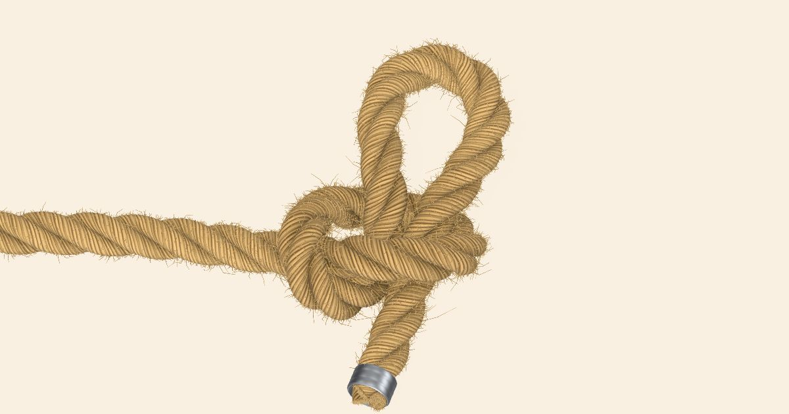<br>Slip knot</a></td>
    <td align="center"><a href="https://knots-made-easy.pages.dev/knots/figure-eight/"><br>Figure-eight knot</a></td>
  </tr>
  <tr>
    <td align="center"><a href="https://knots-made-easy.pages.dev/knots/bowline/"><br>Bowline</a></td>
    <td align="center"><a href="https://knots-made-easy.pages.dev/knots/clove-hitch/"><br>Clove hitch</a></td>
    <td align="center"><a href="https://knots-made-easy.pages.dev/knots/zeppelin/"><br>Zeppelin bend</a></td>
  </tr>
  <tr>
    <td align="center"><a href="https://knots-made-easy.pages.dev/knots/square-knot/"><br>Square knot</a></td>
    <td align="center"><a href="https://knots-made-easy.pages.dev/knots/poachers-knot/"><br>Poacher's knot</a></td>
    <td align="center"><a href="https://knots-made-easy.pages.dev/knots/daisy-chain/">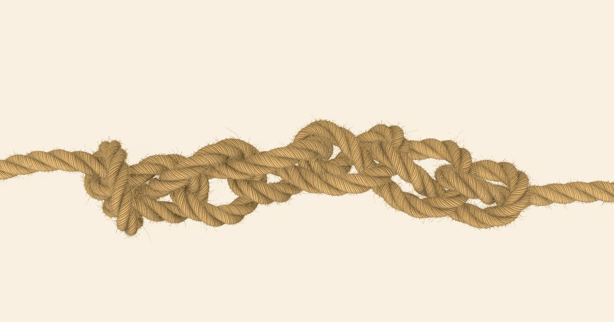<br>Daisy chain</a></td>
  </tr>
  <tr>
    <td align="center">🪢<br><b>More knots are being tied</b><br>Star the repo to see them first</td>
  </tr>
</table>

## Android App

<table>
  <tr>
    <th colspan="2" align="center">Home &amp; Categories (Light &amp; Dark)</th>
  </tr>
  <tr>
    <td align="center">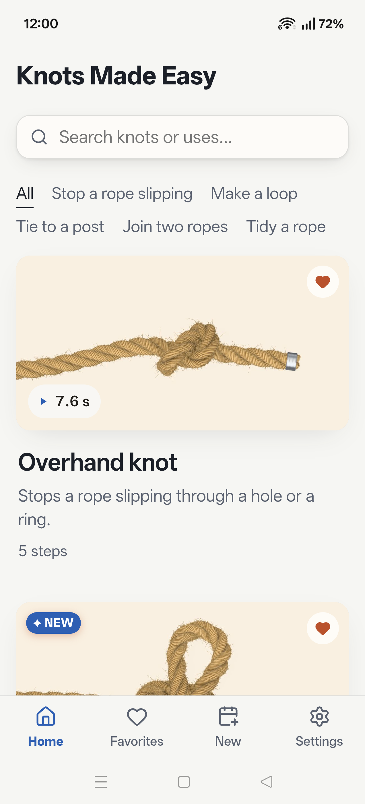</td>
    <td align="center">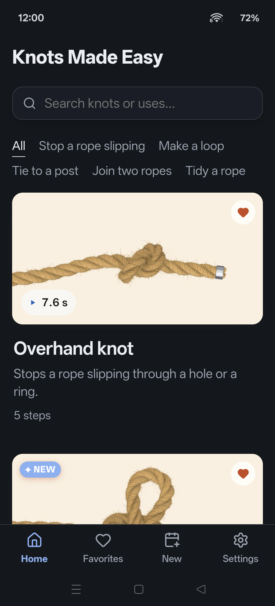</td>
  </tr>
  <tr>
    <th colspan="2" align="center">3D Step-by-Step Viewer (Light &amp; Dark)</th>
  </tr>
  <tr>
    <td align="center">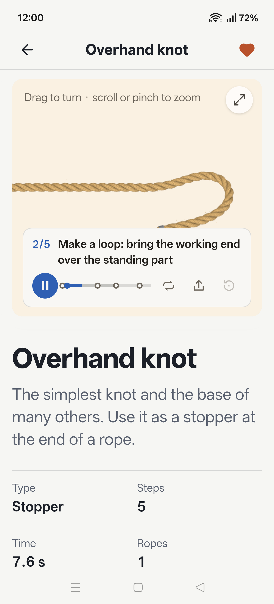</td>
    <td align="center">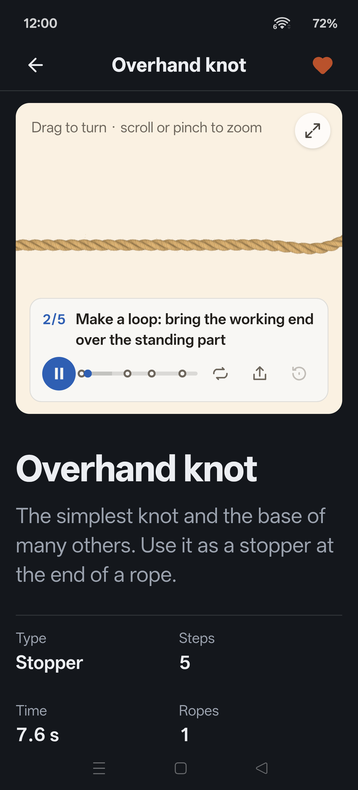</td>
  </tr>
  <tr>
    <th colspan="2" align="center">Settings &amp; Updates (Light &amp; Dark)</th>
  </tr>
  <tr>
    <td align="center">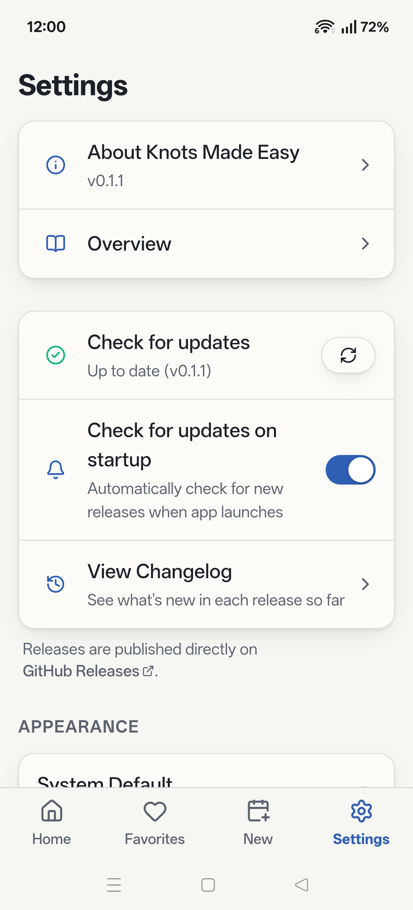</td>
    <td align="center">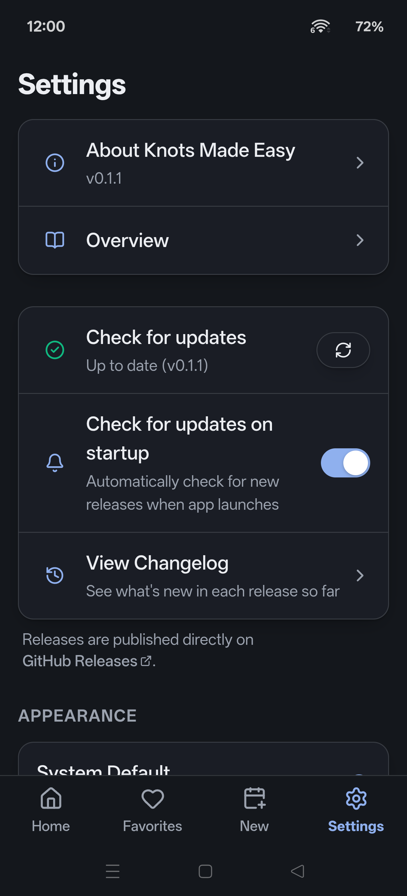</td>
  </tr>
</table>

<details>
<summary>More screenshots (Maximized Viewer, New Tab, Favorites, Share &amp; Import)</summary>

<table>
  <tr>
    <th colspan="2" align="center">3D Viewer — Maximized Mode (Light &amp; Dark)</th>
  </tr>
  <tr>
    <td align="center">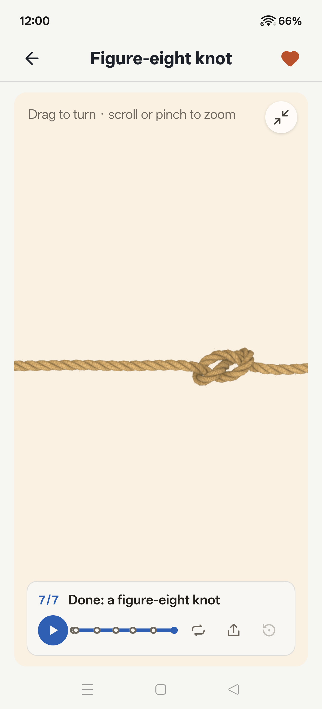</td>
    <td align="center">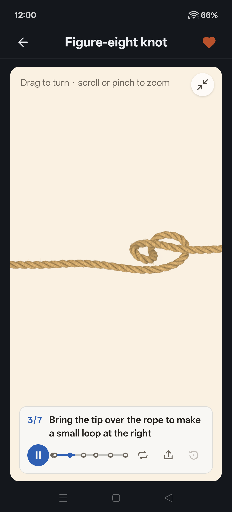</td>
  </tr>
  <tr>
    <th colspan="2" align="center">New Knots Tab (Light &amp; Dark)</th>
  </tr>
  <tr>
    <td align="center">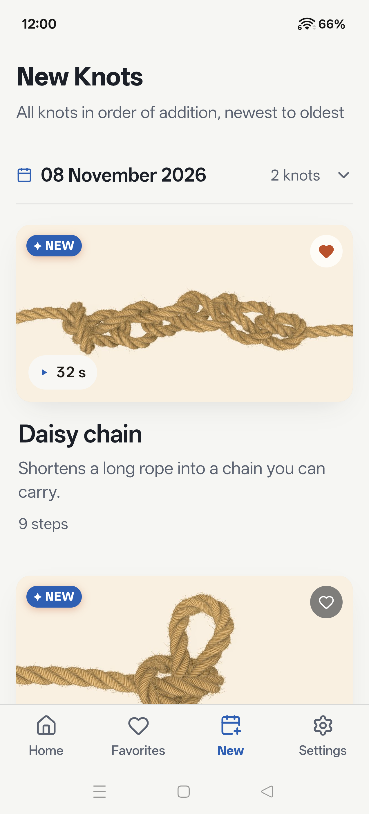</td>
    <td align="center">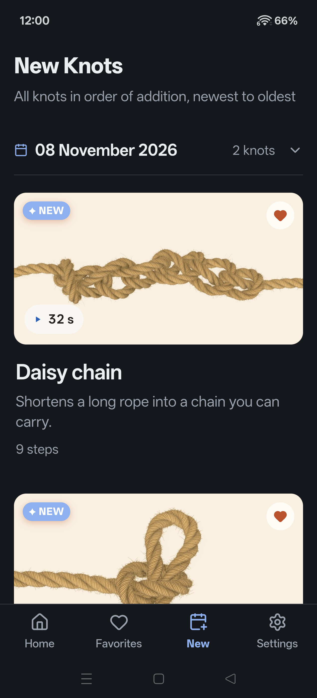</td>
  </tr>
  <tr>
    <th colspan="2" align="center">Favorites (Light &amp; Dark)</th>
  </tr>
  <tr>
    <td align="center">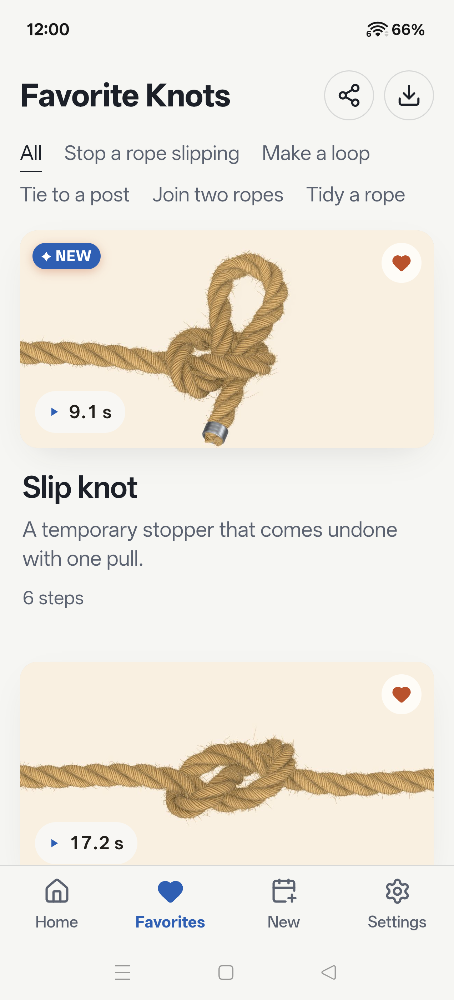</td>
    <td align="center">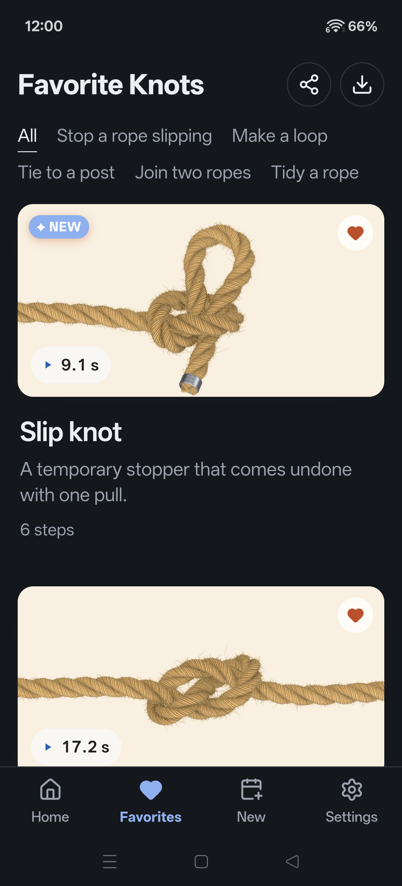</td>
  </tr>
  <tr>
    <th colspan="2" align="center">Share Favorites — QR &amp; Link (Light &amp; Dark)</th>
  </tr>
  <tr>
    <td align="center">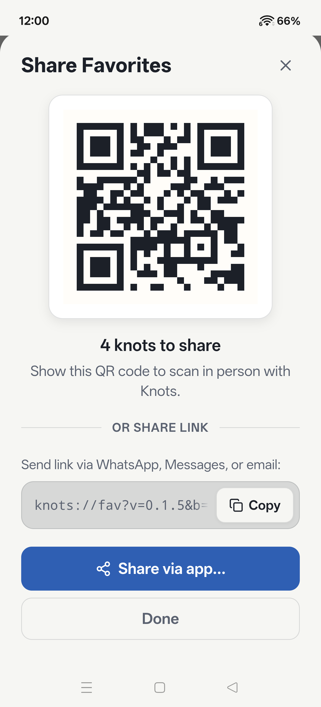</td>
    <td align="center">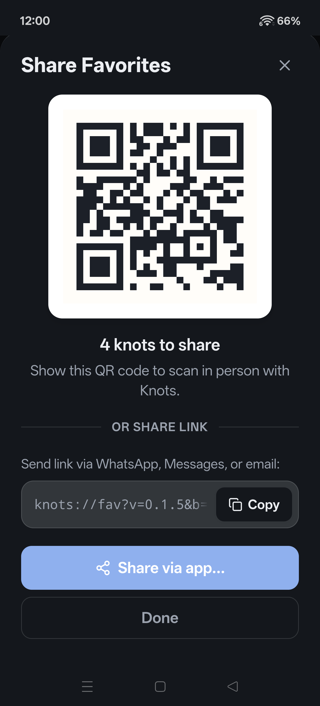</td>
  </tr>
  <tr>
    <th colspan="2" align="center">Import Favorites (Light &amp; Dark)</th>
  </tr>
  <tr>
    <td align="center">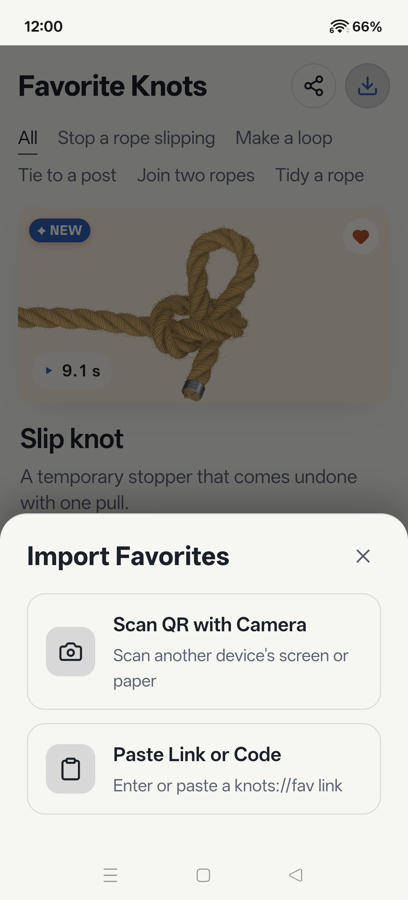</td>
    <td align="center">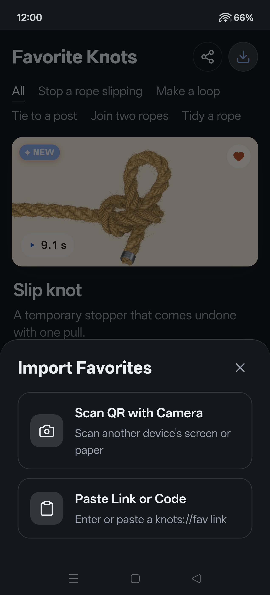</td>
  </tr>
</table>

</details>

## The stargazer rope

Every GitHub star ties a knot. Star the repo and your face joins the rope.

[](https://knots-made-easy.pages.dev/#stargazers)

## Run it

Needs Node 22.22+ and pnpm.

```bash
pnpm install
pnpm dev
```

To build the Android debug APK locally:

```bash
pnpm android:build
```

React, React Router and three.js, no physics library. [AGENTS.md](AGENTS.md) explains the architecture, how to add a knot, submit fixes, and release a new Android version.

## License

[MIT](LICENSE)
